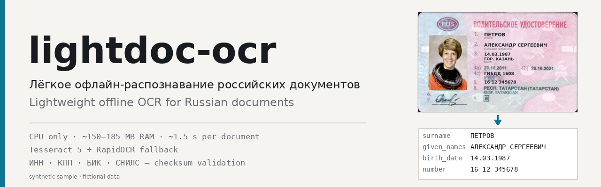

<p align="center">
  
</p>

<h1 align="center">lightdoc-ocr</h1>

<p align="center">
  Лёгкое офлайн-распознавание российских документов: ВУ, реквизиты с проверкой контрольных сумм, JSON. Только CPU.<br>
  Lightweight offline OCR for Russian documents: driver licence, requisites with checksum validation, JSON. CPU only.
</p>

<p align="center">
  <a href="https://github.com/SergeyLubivui-dev/lightdoc-ocr/stargazers"></a>
  <a href="LICENSE"></a>
  
  
  
  <a href="https://github.com/SergeyLubivui-dev/lightdoc-ocr/commits/main"></a>
  
</p>

<p align="center">
  <b>⭐ Поставьте звезду и подпишитесь (Watch) — так проект развивается быстрее</b><br>
  <b>⭐ Star and Watch the repo to follow updates</b><br>
  <a href="https://github.com/SergeyLubivui-dev/lightdoc-ocr">Star / Watch</a> · <a href="https://github.com/SergeyLubivui-dev">Follow @SergeyLubivui-dev</a>
</p>

<p align="center">
  <a href="#русский">Русский</a> · <a href="#english">English</a> · <a href="#установка">Quick start</a> · <a href="#формат-результата">JSON output</a>
</p>

<p align="center"><sub>Topics / Теги: [`ocr`](https://github.com/topics/ocr) [`tesseract`](https://github.com/topics/tesseract) [`opencv`](https://github.com/topics/opencv) [`python`](https://github.com/topics/python) [`russian`](https://github.com/topics/russian) [`document-recognition`](https://github.com/topics/document-recognition) [`driver-license`](https://github.com/topics/driver-license) [`offline`](https://github.com/topics/offline) [`cpu`](https://github.com/topics/cpu) [`rapidocr`](https://github.com/topics/rapidocr)</sub></p>

---

## Русский

Лёгкая офлайн-система распознавания российских документов. Только CPU, без облака: картинки и текст никуда не отправляются.

## Что умеет

- **Водительское удостоверение РФ** (карточка 2011+, лицевая сторона): поиск рамки и выпрямление перспективы, определение типа документа,
  поля (ФИО кириллицей и латиницей, даты, место рождения, орган выдачи, номер, регион, категории по ячейкам), вырезание фото водителя
  с проверкой лица.
- **Произвольная страница / договор** (`free_text`): автоповорот 90/180/270°, порядок чтения с учётом колонок, фильтр шума от печатей,
  исправление «двойников» кириллица↔латиница, реквизиты по каждой стороне договора с проверкой контрольных сумм:
  ИНН (10/12), КПП, БИК, р/с и к/с (ключ по БИК), СНИЛС, ОГРН/ОГРНИП, паспорт, телефоны, даты, e-mail, организации, ФИО.
- Результат — JSON (у каждого поля `confidence`, у реквизитов `valid`) + картинки (`card.jpg`, `photo.jpg`, `debug*.jpg`) + `text.txt`.
- **СТС** (свидетельство о регистрации ТС, лицевая сторона, фото портретной карточки): рег. знак, VIN, марка/модель, тип, категория, год,
  шасси, кузов, цвет, мощность (кВт/л.с.), экологический класс, массы, ПТС, номер СТС. У каждого поля `confidence` и `valid`
  (формат рег. знака с омоглифами, VIN 17 знаков без I/O/Q, ПТС, диапазон года, словари цветов/классов); значения у края карточки помечены `partial`.
  **Марка/модель** на бланке печатается двумя плотными строками (кириллица и латиница): они режутся по профилю проекции, каждая перечитывается в нескольких вариантах кропа
  (Paddle + Tesseract), затем сверяются по транслитерации (КАМАЗ↔KAMAZ) и голосуют вместе, так как модель в обеих строках одна — согласие строк исправляет путаницы S/5, O/0, B/8, Z/2
  (`make_model_ru`, `make_model_lat` и объединённое `make_model` «КАМАЗ 5490-S5 / KAMAZ 5490-S5»). Цвет читается по нескольким окнам со словарным совпадением.
- **СТС, оборот** (адрес владельца, код ГИБДД, дата выдачи, номер СТС вверху и внизу): владелец (кириллица/латиница), регион, район, населённый пункт, улица,
  дом/корпус/квартира, особые отметки, код подразделения ГИБДД, дата выдачи (ISO), номер СТС (верхний и нижний должны совпасть). Сторона определяется автоматически (`extra.side`: `front`/`back`).
- **Паспорт РФ** (разворот, фото с телефона/из интернета, любой поворот 0/90/180/270° и наклон ±10°): орган выдачи, дата выдачи, код подразделения, ФИО, пол,
  дата и место рождения, серия и номер. Серия/номер читаются с красной вертикальной печати у правого края **обеих** страниц (сверяются между собой),
  МРЗ-строки разбираются (транслитерация ГОСТ/приказ МВД, контрольные цифры, 4-я цифра серии, дата выдачи и код подразделения из необязательных данных)
  и **сверяются с печатными полями**: при валидных контрольных суммах путаницы похожих букв исправляются по МРЗ; расхождения помечаются в `note`
  (`печать = МРЗ` / `из МРЗ` / `исправлено по МРЗ` / `РАСХОЖДЕНИЕ`). Валидаторы: правдоподобие дат, выдача не раньше 14-летия (флаг, а не отказ), код подразделения `NNN-NNN`, пол.
  Вырезается фото владельца. Форматы: `--mode passport` форсирует тип.
- **Несколько разворотов на одном листе** (скан/копия): лист режется по пустым промежуткам (XY-разрез по маске «чернил»), каждый кусок классифицируется
  (`main_spread` / `registration` / `passport_page` / `unknown`): основной разворот читается полностью, со страницы регистрации — серия/номер (вертикальная полоса), штампы
  (в т.ч. повёрнутые на 90°: «ЗАРЕГИСТРИРОВАН»), орган регистрации и год/дата best-effort (рукописные записи не распознаются), серия/номер сверяются между страницами.
  Ответ: `document.type=passport_rf`, `pages:[{kind, bbox, found, fields…}]`, `summary:{has_main_spread, has_registration, registration_stamps, series_number_cross_check}`;
  один разворот в кадре обрабатывается как раньше. Код: `docrec/spreads.py`, `docrec/passport_pages.py`.
- **Лексиконы полей** (`docrec/lexicons/<тип>/<поле>.txt.gz`, `shared/…`; ≈145 КБ, грузятся лениво): привязка искажённого OCR-значения к ближайшей записи по
  взвешенному расстоянию Левенштейна с матрицей визуальных путаниц (кириллица↔латиница, 0/8, 5/S/8, Н/М, Б/В…). Привязка только выше порога схожести, иначе значение
  остаётся как есть, уверенность снижается; в `note` — `лексикон: «сырое» → «значение» (расстояние d)`. Типы ТС/цвета/экокласс/марки/модели и суффиксы КАМАЗ (СТС),
  регионы (оборот СТС), имена/отчества/слова органа выдачи/города (паспорт, ВУ), категории/метки ВУ, СНИЛС, удостоверение тракториста, международное ВУ.
  Фамилии **не подменяются** (открытое множество): лексикон только повышает уверенность, а для неизвестных добавляет подсказку «возможна путаница»; названия мест тоже
  не подменяются — только подсказка. Источники — только публичные (Faker ru_RU, OpenCorpora/pymorphy3-dicts-ru, справочники субъектов РФ, ГОСТ/конвенции); сборка: `tools/build_lexicons.py`.
- Заготовки (только опознаются; лексиконы поставляются, экстракторов пока нет): СНИЛС-карта, удостоверение тракториста-машиниста, международное водительское удостоверение.

### Поддерживаемые типы

| Тип | Статус | Поля |
|---|---|---|
| Водительское удостоверение РФ (2011+, лицо) | полностью | 18 полей, фото, категории по ячейкам |
| СТС (лицо) | полностью | 15 полей + марка/модель на двух языках, валидаторы, `partial` у края |
| Страница / договор | полностью | текст, реквизиты с контрольными суммами |
| СТС (оборот) | полностью | 13 полей: адрес, код ГИБДД, дата выдачи, номер СТС |
| Паспорт РФ (разворот) | полностью | 11 полей + МРЗ, серия/номер с двух страниц, фото |
| Паспорт РФ (лист из нескольких разворотов) | полностью | `pages[]`: основной разворот (11 полей), регистрация (штамп, орган, серия/номер), сверка серии |
| СНИЛС-карта, удостоверение тракториста, международное ВУ | заготовка | опознаются; лексиконы поля готовы |

### Привязка полей по последовательности

Значения на бланках часто смещены относительно подписей (особенно бледная машинная печать в СТС). Поэтому тип документа задаёт
**упорядоченный список подписей**; подписи ищутся нечётко (с учётом омоглифов), затем динамическим программированием выбирается
максимальная **монотонная** цепочка (пропущенная или искажённая подпись не ломает остальные — её позиция интерполируется), а строки значений
распределяются между соседними подписями с оценкой общего сдвига. Для бледной печати слои разделяются: тёмные подписи читает Tesseract,
значения (с вычтенными подписями и усиленным контрастом) — Paddle, затем выбирается лучший вариант по каждому полю (`valid`, затем `confidence`).
Для ВУ те же идеи применены к калибровке шаблона (монотонный отбор подписей), шаблонные зоны остаются запасом. Код: `docrec/anchors.py`, `docrec/ink.py`, `docrec/doctypes/sts.py`, `docrec/doctypes/sts_back.py`, `docrec/makemodel.py` (марка/модель, цвет).
Паспорт: `docrec/doctypes/passport.py` и `docrec/mrz.py`; там весь разворот прогоняется Paddle (длинная сторона до 1800 px) после выбора ориентации и выпрямления наклона,
страницы делятся по позициям подписей, значения чистятся словарём (омоглифы, слова органа выдачи) и лексиконами (`docrec/lexicon.py`).

## Стек

Python 3.11+, **Tesseract 5.5** через `tesserocr` (tessdata_best, rus+eng; движок внутри wheel), запасной движок
**RapidOCR PP-OCRv5 mobile** (onnxruntime), OpenCV (поиск карточки, перспектива), **YuNet** (проверка лица). Все модели лежат в репозитории
(`docrec/models`, ~60 МБ), интернет после установки не нужен.

## Требования к железу

Только CPU, GPU не нужен; 2 ядер достаточно (Tesseract однопоточный). Пик RAM: **~150–185 МБ** (Tesseract), до **~350 МБ**, если сработал
запасной проход Paddle (СТС всегда использует оба движка: **~330–430 МБ**, ≈ **3–6 с**; паспорт — **~450–950 МБ**, ≈ **8–10 с** на 1 ядре в режиме auto, т.к. сначала отрабатывает карточный проход; с `--mode passport` ≈ 3 с). Замер на Ryzen 9 5900X (Windows, 1 процесс): ВУ ≈ **1.5 с**, страница A4 (1600×1200) ≈ **2.1 с**.
`--fast` (tessdata_fast) быстрее примерно на 30 %, но чуть хуже по кириллице.

## Установка

```bash
# Linux/macOS                      # Windows (PowerShell)
sh setup.sh                        .\setup.ps1
```
или вручную: `python -m venv .venv && pip install -r requirements.txt`. `rapidocr` необязателен (без него работает только Tesseract).

## Использование

```bash
python recognize.py photo.jpg --out out/                  # --mode auto (по умолчанию)
python recognize.py contract.jpg --out out/ --mode page   # лист / договор: текст + реквизиты
python recognize.py licence.jpg --out out/ --mode card    # удостоверение
python recognize.py passport.jpg --out out/ --mode passport   # паспорт РФ (в auto определяется сам)
# --engine tess|paddle   --fast   --threads N   --quiet
```
```python
from docrec import DocumentPipeline
res = DocumentPipeline(mode="auto").process("photo.jpg", "out/")   # dict = result.json
```
Windows: `run_docrec.bat <image> [out_dir]`. Тестовые изображения с вымышленными данными: `samples/` (генераторы: `tools/make_synthetic*.py`; оценка: `tools/eval_synth.py`, `tools/eval_synth_sts.py` — лицо и оборот СТС, `tools/eval_synth_passport.py`). Примеры результата: `examples/synth_passport/`, `examples/synth_sts_back/`.

## Формат результата

Карточка (`examples/synth1/result.json`, вымышленные данные):
```json
{"doc_type": "driver_license_rf", "confidence": 0.95,
 "corners": {"order": "TL,TR,BR,BL", "points": [[304.1, 459.1], "..."]},
 "fields": {
   "surname": {"value": "ПЕТРОВ", "confidence": 0.99},
   "given_names": {"value": "АЛЕКСАНДР СЕРГЕЕВИЧ", "confidence": 0.99},
   "birth_date": {"value": "14.03.1987", "confidence": 1.0, "valid": true},
   "number": {"value": "16 12 345678", "confidence": 0.96, "valid": true},
   "categories": {"value": ["B"], "confidence": 0.85, "valid": true}},
 "photo": {"face_detected": true}, "timings_sec": {"total": 1.1}, "peak_rss_mb": 183}
```
Страница (`examples/synth_page/result.json`): `text`, `lines[]`, `parties[]` (`role`, `name`, `requisites[]`), плоский `requisites[]`:
```json
{"type": "inn", "value": "7708123450", "valid": true, "confidence": 0.947, "party": "Заказчик"}
{"type": "settlement_account", "value": "40702810700001234567", "valid": true, "confidence": 0.947, "party": "Заказчик"}
```
Также: `page_rotation_applied_ccw`, `validation_issues`, `noise_filtered`, `warnings`, `engine_fallback`.
Если контрольная сумма не сходится, а исправление одной цифры из типичных путаниц OCR единственно, значение исправляется и в `note` пишется причина.

## Как добавить тип документа

1. Создайте `docrec/doctypes/my_doc.py`:
```python
from .base import DocType, Extraction, Field, register

@register
class MyDoc(DocType):
    name = "my_doc"
    card_size = (1026, 648)                      # размер нормализованной карточки, px
    keywords = [("КЛЮЧЕВАЯ ФРАЗА", 3), ("ЕЩЁ ФРАЗА", 1)]   # (фраза, вес) для классификатора
    expected_fields = ["number"]                 # для оценки «слабого» результата

    def extract(self, card, lines, rec=None, cell=None) -> Extraction:
        ex = Extraction()
        ex.fields["number"] = Field("123", 0.9, valid=True)   # зоны задаются долями карточки
        return ex
```
2. Добавьте импорт в `docrec/doctypes/__init__.py`. Классификатор, выпрямление и вызов `extract` подхватятся из реестра.
   `lines` — строки OCR с координатами (`x0,y0,x1,y1,cx,cy,score`), `cell(img, whitelist, psm)` — перечитать маленький кроп.
3. Отладка: `debug_card.jpg` (зоны шаблона и боксы OCR).

## Ограничения

- ВУ 2011+, лицевая сторона; старые ВУ, оборот, ВУ с другой версткой — не проверялись.
- Tesseract плохо читает совсем мелкую латиницу (<~10 px) и сильный блик; при слабом результате включается Paddle-запас (если установлен).
- Страница: печать поверх текста закрывает слова; наклон >10–15° не выпрямляется (поворот только кратный 90°).
- Низкое разрешение (карточка < ~700 px по ширине) резко ухудшает цифры (`warnings: low_resolution`).
- СТС: проверено на одном реальном (лицо и оборот) и синтетических снимках; суффикс модели (S↔5), длинные значения у обреза карточки и цвет читаются хуже, смотрите `confidence`/`partial`. Марка/модель: разбор рассчитан на вид «МАРКА 1234-XX» (КАМАЗ, ЛАДА, ГАЗ…); модели без цифрового номера (названия словами) читаются по старой схеме без сверки языков; неоднозначность S/5 и 0/8 разрешается голосованием двух строк, второй проход по цифровой части (Tesseract с белым списком цифр), списком известных моделей и суффиксов КАМАЗ — при расхождении строк уверенность снижается, варианты в `note`. Глифовые признаки (дырки/заливка 0 vs 8) на размытой матричной печати ненадёжны и не используются как основной критерий. Склейка лица и оборота в один результат не реализована. Код ГИБДД на бледных/зачёркнутых бланках может не читаться; СНИЛС-карта пока только опознаётся.
- Паспорт: наклон выпрямляется поворотом (±10°), перспектива (снимок под углом) не исправляется; на снимках <~500 px по ширине серия/номер и мелкие слова органа выдачи читаются с ошибками (В↔Б, И↔П), при этом `confidence` ниже; МРЗ на нечётких/поддельных образцах может быть внутренне несогласован — тогда стоит `РАСХОЖДЕНИЕ`, а в поле остаётся печатное значение. Основной разворот читается полностью; со страницы регистрации — только штамп/орган/серия-номер best-effort (рукописный текст не распознаётся). Размытые копии: фамилия может читаться с путаницей М/Н — смотрите `note` (варианты чтения). Проверено на небольшом числе реальных и синтетических снимков — не заменяет ручной контроль.
- Не используйте для чужих документов без законного основания; обработка персональных данных регулируется законом.

## Лицензии

Код — MIT (`LICENSE`). Сторонние компоненты: Tesseract и tessdata_best (Apache-2.0), PaddleOCR / RapidOCR и модели PP-OCRv5 (Apache-2.0),
OpenCV и YuNet (Apache-2.0), onnxruntime (MIT), tesserocr (MIT). Примеры в `samples/spec3.png` — публичный образец документа (public domain / Wikimedia Commons);
лицо в `samples/face.png` — тестовое изображение из scikit-image (NASA, public domain). Все данные в `samples/` и `examples/` вымышлены.

---

<a id="english"></a>
# lightdoc-ocr (English)

Lightweight, fully offline recognition of Russian documents. CPU-only; no image or text ever leaves the machine.

## Features

- **Russian driver licence** (2011+ card, front side): card detection and perspective crop, document-type classification, fields
  (name in Cyrillic and Latin, dates, place of birth, issuer, number, region, categories read cell by cell), driver photo crop with face check.
- **Free-text pages / contracts** (`free_text`): auto-rotation (90/180/270°), column-aware reading order, stamp-noise filtering,
  Latin↔Cyrillic homoglyph fixes, per-party requisites with checksum validation: INN (10/12), KPP, BIK, settlement/correspondent accounts
  (BIK-keyed), SNILS, OGRN/OGRNIP, passport, phones, dates, e-mail, organisations, person names.
- Output: JSON (per-field `confidence`, requisites carry `valid`) + images (`card.jpg`, `photo.jpg`, `debug*.jpg`) + `text.txt`.
- **Vehicle registration certificate (STS)**, front side, portrait card photo: plate, VIN, make/model, type, category, year, chassis, body,
  colour, power (kW/hp), eco class, masses, PTS, STS number. Each field has `confidence` and `valid` (plate format with homoglyphs, 17-char VIN without I/O/Q,
  PTS, year range, colour/class vocabularies); values cut by the card edge are flagged `partial`.
  **Make/model** is printed on two tightly stacked lines (Cyrillic and Latin): they are split by a projection profile, each is re-read in several crop variants
  (Paddle + Tesseract), then cross-checked by transliteration (КАМАЗ↔KAMAZ) and voted on jointly, since the model part is the same on both lines — agreement fixes S/5, O/0, B/8, Z/2 confusions
  (`make_model_ru`, `make_model_lat` and the combined `make_model` "КАМАЗ 5490-S5 / KAMAZ 5490-S5"). Colour is read from several windows with a dictionary match.
- **STS, back side** (owner address, GIBDD code, issue date, STS number top and bottom): owner (Cyrillic/Latin), region, district, locality, street,
  house/building/apartment, special marks, GIBDD unit code, issue date (ISO), STS number (top and bottom copies must agree). The side is detected automatically (`extra.side`: `front`/`back`).
- **Russian passport** (the photo-page spread, phone/web photos, any 0/90/180/270° rotation and ±10° skew): issuing authority, issue date, department code, name, sex,
  birth date and place, series and number. Series/number are read from the red vertical print at the right edge of **both** pages (and must agree);
  the MRZ lines are parsed (Russian transliteration, check digits, 4th series digit, issue date and department code from the optional data)
  and **cross-checked against the printed fields**: with valid checksums, look-alike letter confusions are corrected from the MRZ; disagreements are reported in `note`
  (`printed = MRZ` / `from MRZ` / `corrected from MRZ` / `MISMATCH`). Validators: plausible dates, issue not before the 14th birthday (flag, not rejection), department code `NNN-NNN`, sex.
  The holder photo is cropped. `--mode passport` forces the type.
- **Several passport spreads on one sheet** (scan/photocopy): the sheet is cut at empty gutters (XY-cut over an ink mask) and every piece is classified
  (`main_spread` / `registration` / `passport_page` / `unknown`): the main spread is read in full; from the registration page we read the series/number (vertical strip), stamps
  (including 90°-rotated "ЗАРЕГИСТРИРОВАН"), the registering authority and a year/date on a best-effort basis (handwriting is not recognised); series/number are cross-checked across pages.
  Output: `document.type=passport_rf`, `pages:[{kind, bbox, found, fields…}]`, `summary:{has_main_spread, has_registration, registration_stamps, series_number_cross_check}`;
  a single spread in the frame is processed as before. Code: `docrec/spreads.py`, `docrec/passport_pages.py`.
- **Field lexicons** (`docrec/lexicons/<doctype>/<field>.txt.gz`, `shared/…`; ≈145 KB, lazily loaded): a garbled OCR value is snapped to the nearest entry by a
  weighted Levenshtein distance with a visual-confusion matrix (Cyrillic↔Latin look-alikes, 0/8, 5/S/8, Н/М, Б/В…). Snapping happens only above a similarity threshold, otherwise the value
  stays as is with lower confidence; `note` records `лексикон: «raw» → «value» (distance d)`. Vehicle type/colour/eco class/makes/models and KAMAZ suffixes (STS),
  regions (STS back), first names/patronymics/issuer words/cities (passport, licence), licence categories/marks, SNILS, tractor licence, international driving permit.
  Surnames are **never substituted** (open set): the lexicon only boosts confidence and adds a "possible confusion" hint for unknown ones; place names are hint-only too.
  Public sources only (Faker ru_RU, OpenCorpora/pymorphy3-dicts-ru, official region lists, conventions); build with `tools/build_lexicons.py`.
- Stubs (classification only; lexicons shipped, extractors pending): SNILS card, tractor-driver licence, international driving permit.

### Supported types

| Type | Status | Fields |
|---|---|---|
| Russian driver licence (2011+, front) | full | 18 fields, photo, per-cell categories |
| STS (front) | full | 15 fields + bilingual make/model, validators, `partial` at the edge |
| Free-text page / contract | full | text, checksum-validated requisites |
| STS (back) | full | 13 fields: address, GIBDD code, issue date, STS number |
| Russian passport (spread) | full | 11 fields + MRZ, series/number from both pages, photo |
| Russian passport (multi-spread sheet) | full | `pages[]`: main spread (11 fields), registration (stamp, authority, series/number), series cross-check |
| SNILS card, tractor licence, international permit | stub | classification only; field lexicons ready |

### Sequence-anchored field matching

Values on forms are often shifted relative to their labels (especially the faint typed text on the STS). Each document type therefore declares
an **ordered list of labels**; labels are fuzzy-matched (homoglyph-aware), a dynamic program keeps the longest **monotone** chain (a missed or garbled label
does not break the others — its position is interpolated), and value lines are assigned between neighbouring labels with a global shift estimate.
For faint print the ink layers are separated: dark labels go to Tesseract, values (labels masked out, contrast boosted) go to Paddle; the best candidate per field wins
(`valid`, then `confidence`). The driver licence uses the same idea for template calibration (monotone label selection); template zones stay as the fallback.
Code: `docrec/anchors.py`, `docrec/ink.py`, `docrec/doctypes/sts.py`, `docrec/doctypes/sts_back.py`, `docrec/makemodel.py` (make/model, colour).
Passport: `docrec/doctypes/passport.py` and `docrec/mrz.py`; the whole spread goes through Paddle (long side up to 1800 px) after orientation and skew correction,
pages are split by label positions, values are cleaned with vocabularies (homoglyphs, issuer words) and lexicons (`docrec/lexicon.py`).

## Stack

Python 3.11+, **Tesseract 5.5** via `tesserocr` (tessdata_best, rus+eng; the engine is bundled in the wheel), fallback **RapidOCR PP-OCRv5 mobile**
(onnxruntime), OpenCV (card detection, perspective), **YuNet** (face check). All models are in the repo (`docrec/models`, ~60 MB); no internet needed after install.

## Hardware

CPU only, no GPU; 2 cores are enough (Tesseract is single-threaded). Peak RAM **~150–185 MB** (Tesseract), up to **~350 MB** when the Paddle fallback kicks in (the STS always uses both engines: **~330–430 MB**, ≈ **3–6 s**; the passport **~450–950 MB**, ≈ **8–10 s** single-core in auto mode because the card pass runs first; ≈ 3 s with `--mode passport`).
Measured on a Ryzen 9 5900X (Windows, one process): driver licence ≈ **1.5 s**, A4 page (1600×1200) ≈ **2.1 s**. `--fast` (tessdata_fast) is ~30 % faster, slightly less accurate on Cyrillic.

## Install

```bash
sh setup.sh          # Linux/macOS          .\setup.ps1   # Windows
```
or `python -m venv .venv && pip install -r requirements.txt`. `rapidocr` is optional (Tesseract alone works without it).

## Usage

```bash
python recognize.py photo.jpg --out out/                  # --mode auto (default)
python recognize.py contract.jpg --out out/ --mode page   # page / contract: text + requisites
python recognize.py licence.jpg --out out/ --mode card
python recognize.py passport.jpg --out out/ --mode passport   # auto detects it too
# --engine tess|paddle   --fast   --threads N   --quiet
```
```python
from docrec import DocumentPipeline
res = DocumentPipeline(mode="auto").process("photo.jpg", "out/")   # dict, same as result.json
```
Windows: `run_docrec.bat <image> [out_dir]`. Test images with fictional data are in `samples/` (generators: `tools/make_synthetic*.py`; evaluation: `tools/eval_synth.py`, `tools/eval_synth_sts.py` — STS front and back, `tools/eval_synth_passport.py`). Result examples: `examples/synth_passport/`, `examples/synth_sts_back/`.

## Output

See `examples/synth1/result.json` (licence card, fictional data) and `examples/synth_page/result.json` (page). Card: `doc_type`, `confidence`, `corners`,
`fields{value, confidence, valid?, note?}`, `photo`, `timings_sec`, `peak_rss_mb`. Page: `text`, `lines[]`, `parties[]`, flat `requisites[]`
(`type`, `value`, `valid`, `confidence`, `party`, `note`), `page_rotation_applied_ccw`, `validation_issues`, `noise_filtered`, `engine_fallback`.
If a checksum fails and exactly one single-digit fix (from typical OCR confusions) satisfies it, the value is corrected and `note` says so.

## Adding a document type

Create `docrec/doctypes/my_doc.py` with a `@register`-ed `DocType` subclass (`name`, `card_size`, `keywords`, optional `expected_fields`, and
`extract(card, lines, rec=None, cell=None) -> Extraction`), then import it in `docrec/doctypes/__init__.py`. Classification, rectification and dispatch are picked
up from the registry (see the example in the Russian section). Debug with `debug_card.jpg`.

## Limitations

- Driver licence 2011+ front side only; older licences, the back side and other layouts are untested.
- Tesseract struggles with very small Latin text (<~10 px) and strong glare; the Paddle fallback (if installed) covers part of these cases.
- Pages: stamps over text hide words; skew >10–15° is not corrected (only 90° steps).
- Low resolution (card narrower than ~700 px) hurts digits (`warnings: low_resolution`).
- STS: tested on one real (front and back) and synthetic photos; the model suffix (S↔5), long values cut at the card edge and colour are read less reliably — see `confidence`/`partial`. Make/model parsing expects the "MAKE 1234-XX" form (KAMAZ, LADA, GAZ…); names without a numeric model use the old single-line path without the language cross-check; S/5 and 0/8 ambiguity is resolved by two-line voting, a second digits-only pass (Tesseract with a digit whitelist), and the list of known KAMAZ models/suffixes — when the lines disagree confidence is lowered and the alternatives are in `note`. Glyph features (holes/fill of 0 vs 8) are unreliable on blurry dot-matrix print and are not the primary criterion. Merging front and back into one result is not implemented. The GIBDD code on faint/struck-through forms may be unreadable; the SNILS card is a classification stub.
- Passport: skew is fixed by rotation (±10°), perspective (shots at an angle) is not corrected; on photos narrower than ~500 px the series/number and small issuer words are read with errors (В↔Б, И↔П) with lower `confidence`; the MRZ of blurry/fake specimens may be internally inconsistent — then `MISMATCH` is reported and the printed value is kept. The main spread is read in full; from a registration page only the stamp/authority/series-number are read best-effort (handwriting is not recognised). Blurry copies: the surname may be read with М/Н confusion — see `note` (reading variants). Tested on a small set of real and synthetic images — not a substitute for manual review.
- Do not process other people's documents without a legal basis; personal data processing is regulated by law.

## Licenses

Code: MIT (`LICENSE`). Third-party: Tesseract and tessdata_best (Apache-2.0), PaddleOCR / RapidOCR and PP-OCRv5 models (Apache-2.0),
OpenCV and YuNet (Apache-2.0), onnxruntime (MIT), tesserocr (MIT). `samples/spec3.png` is a public specimen (public domain / Wikimedia Commons); the face in
`samples/face.png` is a scikit-image test image (NASA, public domain). All data in `samples/` and `examples/` is fictional.
